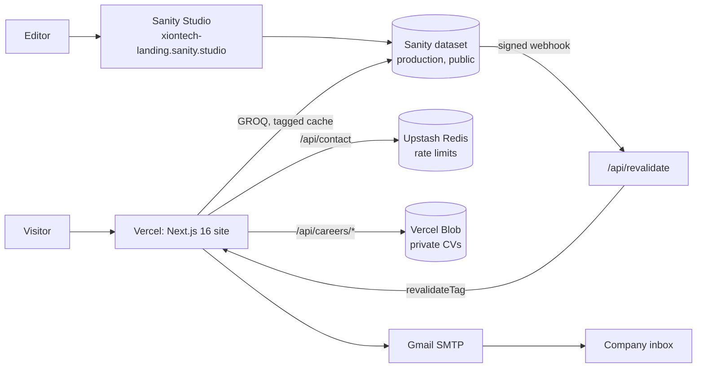

# Architecture

How the XionTech landing page is built, why, and where each decision is recorded. Written 2026-10-05, when 29 of the 31 Demo-day stories were merged (7.3 and 7.4 open; after-demo stories such as 1.2, 4.4, 4.5 and 5.3 are not built). Specs: `_bmad-output/implementation-artifacts/`. Keep this file current in the same PR as any change it describes (AGENTS.md). The BMad architecture step was skipped in planning; its decisions live in `_bmad-output/specs/decisions-2026-10-01.md` (T1 to T11, A1 to A11), `docs/spikes/cms-spike.md`, `docs/sanity.md` and `docs/contact-delivery.md`. This file ties them together.

## 1. The big picture

- **No database of our own.** Published content lives in Sanity; CVs live in a private Blob store until they are mailed or deleted; every form ends as an email.
- **Everything is on free plans** (Vercel Hobby, Sanity Free, Upstash Free, Gmail). Limits are in section 8.

## 2. Environments

| Branch    | URL                                       | Notes                                                    |
| --------- | ----------------------------------------- | -------------------------------------------------------- |
| `main`    | https://xion-tech-landing-page.vercel.app | Production. Changed only by a release PR from `develop`. |
| `develop` | https://xiontech-dev.vercel.app           | Integration. Every story PR merges here.                 |
| PR branch | Vercel preview URL                        | One per PR.                                              |

Both sites read the same Sanity dataset (`1khn3hf4` / `production`), so a publish shows on both. Today only the dev site's webhook exists; the production webhook is added after the first release, and until then production refreshes only on a deploy. Secrets live only in Vercel env vars and each developer's `.env.local` (names in `.env.example`, values never in git).

## 3. The website

- **Framework:** Next.js 16 App Router, React 19, TypeScript strict, Tailwind v4 (tokens in `src/app/globals.css`).
- **Server first.** Pages are Server Components: the HTML holds the real content, so it works without JavaScript and search engines see it. Client code only where something must react in the browser: the mobile menu and desktop mega menus, the hero and inner-page hero animations, the PXP story tabs, the 4-D flow reveal, the News filter chips, the office clocks (Services and About), and the forms.
- **Routes:**

| Route                         | Story         | Content source                       |
| ----------------------------- | ------------- | ------------------------------------ |
| `/`                           | 3.1 to 3.7    | Code, plus the 3 newest Sanity posts |
| `/products`                   | 4.1 to 4.3    | Code                                 |
| `/services`                   | 5.1, 5.2, 5.4 | Code (clocks run in the browser)     |
| `/about`                      | 6.4           | Code                                 |
| `/news`, `/news/[slug]`       | 6.1, 6.2      | Sanity `post`                        |
| `/careers`, `/careers/[slug]` | 6.5, 6.6, 6.3 | Sanity `job` and `careersPhotos`     |
| `/demo`                       | 2.2           | Code (contact form)                  |
| `/privacy`                    | 2.1           | Code (`[Placeholder]` policy)        |
| Not found                     | 1.7           | Code; real HTTP 404                  |

- **Code layout:** `src/app` (routes and API), `src/components/<area>` (UI by page area), `src/lib/<area>` (data reads, rules, helpers), `src/content` (all page copy, kept apart so it can be translated later).

## 4. Content from Sanity

### Reading

- **One fetch helper** (`src/lib/sanity/client.ts`, `sanityFetch`). Every read uses `cache: "force-cache"` and one cache tag (`post`, `job`, `careersPhotos`; `product` is accepted by the webhook but no page reads it until Story 4.4). Each page writes its own GROQ query next to its feature (decision T2); there is no shared content module.
- **No CDN for data** (A11): the Sanity API CDN once served old data right after a publish. Next.js caches every result instead, so Sanity is read only on a build, on the first visit to a page or slug, and after a webhook.
- **Never** `force-dynamic`, `no-store` or a timed `revalidate` on a Sanity read: each uncached read counts against the free 250k API requests a month.
- **Only complete posts show** (A9): a post needs an English title, a slug and a publish date. A role needs an English title and a slug and must not be closed.
- **Unknown addresses are cheap.** `/news/[slug]` checks the slug against the cached post list before it asks Sanity (6.2). `/careers/[slug]` still asks Sanity directly (follow-up in `deferred-work.md`).
- **A Sanity outage never breaks the Home news section or the News list:** the error is logged and the section shows its empty state. A story page, `/careers` and a job page still fail (no branded error page yet); a failed build keeps the last good deploy live on Vercel. Both are follow-ups in `deferred-work.md`.

### Publishing (Story 6.3)

1. An editor changes a post, a role, the Careers photos or a product clip in Studio and publishes.
2. Sanity calls `POST /api/revalidate` with a signed body (`SANITY_REVALIDATE_SECRET`). The route rejects a bad signature (401), an unknown type (400) or a missing secret (500).
3. The route calls `revalidateTag(<type>, "max")`: the next visit still gets the old page and triggers a fresh read; the visit after that shows the change. In the 6.3 live proof on 2026-10-05 (6.3 ledger) a publish, an edit, a delete and a closed role each showed on the dev site within about 10 seconds, with no deploy.

The Studio is hosted by Sanity (outside our build). It lists News posts and Job openings, and two fixed-document sections: **Careers photos** (team, office, event: photo, alt text, caption) and **Products** (PXP, LXP, SXP, IoT: an mp4 clip, not shown on any page until Story 4.4). Who may edit is set by project members in sanity.io/manage; the site has no login. Datasets on the free plan are public, so only consented photos and no personal data go into Sanity.

## 5. Forms and email

### Contact and demo (`POST /api/contact`, Stories 2.2 to 2.4)

1. A hidden honeypot field: filled means a bot, answered 200 and dropped.
2. The same field checks as the browser (shared rules in `src/lib/contact`).
3. **Rate limits** in Upstash Redis: about 5 per 10 minutes per IP and email, 20 per hour per IP.
4. **Gmail SMTP** (`nodemailer`, an app password) sends the request to `CONTACT_INBOX`.

### Job applications (Story 6.6, decisions T1 and A10)

1. The browser asks `POST /api/careers/cv-upload` for a short upload token (about 5 per IP per hour; type and 5 MB limits; random file name).
2. The browser uploads the CV straight into a **private Vercel Blob** store, so the 4.5 MB function limit does not apply.
3. `POST /api/careers/apply` repeats every check, applies the contact rate limits, checks the role is open and the stored CV is real, and mails the application with the CV attached.
4. If the mail is not sent after the rate limits passed, the CV is deleted. Applications are never stored in Sanity.

## 6. Security choices

- Secrets only in env vars; the form routes log only the step and the error class; the Sanity reads log the error object, which holds no personal data.
- Signed webhook; allow-lists for webhook types, upload paths and file types.
- Every form: honeypot, server-side checks, rate limits; personal data only in form bodies, never in URLs.
- Fixed Sanity queries with parameters (no string building); React escapes all content.
- Known gaps: the rate limits let traffic through when Upstash is down, and no cleanup job removes CVs left in Blob (`deferred-work.md`); the Studio's no-create and mp4-only rules are UI only, so a member with write access could still change data through the Sanity API (6.3 review row 7; check project roles before Story 4.4).

## 7. Quality gates

| Gate                                              | Command                                                     | When                                                                         |
| ------------------------------------------------- | ----------------------------------------------------------- | ---------------------------------------------------------------------------- |
| Lint (incl. SonarQube JS/TS rules), types, format | `npm run lint && npm run typecheck && npm run format:check` | every change; the `pre-push` hook runs lint                                  |
| Build                                             | `npm run build`                                             | before every PR                                                              |
| Unit tests + 100% of changed lines, C1 ≥ 80%      | `npm run test:coverage && npm run coverage:diff`            | every change                                                                 |
| Smoke (boot, key pages, 404s, honeypots)          | `npm run test:smoke`                                        | every change                                                                 |
| Browser walk of the UX checks table               | story `walk.mjs`                                            | every UI story                                                               |
| Review                                            | `bmad-code-review` (5 layers)                               | once per PR                                                                  |
| SonarQube full gate                               | `npm run sonar:gate:full`                                   | daily on `develop`, before the release — **local only, never the XT server** |

## 8. Free-plan limits that matter

| Service             | Limit                                                   | How we stay inside it                                                                |
| ------------------- | ------------------------------------------------------- | ------------------------------------------------------------------------------------ |
| Sanity Free         | 250k API requests/month, 10k documents, public datasets | tag cache, no CDN, no timed refresh, unknown slugs cost nothing                      |
| Vercel Hobby        | 4.5 MB function body; image optimization quota          | CVs go straight to Blob; Sanity images are resized by Sanity and shown `unoptimized` |
| Vercel Blob (Hobby) | 1 GB                                                    | CVs deleted when not sent; cleanup job after Demo day                                |
| Upstash Free        | command quota                                           | sliding windows per IP and IP+email                                                  |

## 9. Decision index

The decisions that shape the architecture; the full list (T1 to T11, A1 to A11) is in `_bmad-output/specs/decisions-2026-10-01.md`. A4 keeps sent applications (the mail and its CV in the inbox) with no time limit; A10 deletes only CVs that were never sent.

| ID  | Decision                                                           | Where                                                                      |
| --- | ------------------------------------------------------------------ | -------------------------------------------------------------------------- |
| T1  | CVs in a private Vercel Blob store                                 | decisions file                                                             |
| T2  | One tagged fetch helper; each page owns its query                  | decisions file                                                             |
| T4  | Free mail sender and shared rate-limit store                       | decisions file; result in `docs/contact-delivery.md`                       |
| A4  | Applications kept with no time limit                               | decisions file                                                             |
| A9  | Real posts; complete posts only; Home survives a Sanity failure    | decisions file                                                             |
| A10 | CV attached to the mail; deleted when unsent after the rate limits | decisions file                                                             |
| A11 | No Sanity CDN for data                                             | decisions file                                                             |
| 6.3 | Careers photos singleton, product clips upload only                | `_bmad-output/implementation-artifacts/spec-6-3-editors-publish-sanity.md` |

## 10. Open before Demo day

- Release `develop` to `main` (production is far behind), then add the production webhook.
- Stories 7.3 (accessibility checks) and 7.4 (performance budget): until then there is no automated accessibility or Lighthouse gate.
- The 6.3 Studio check by hand (fixed documents, one-slot upload).
